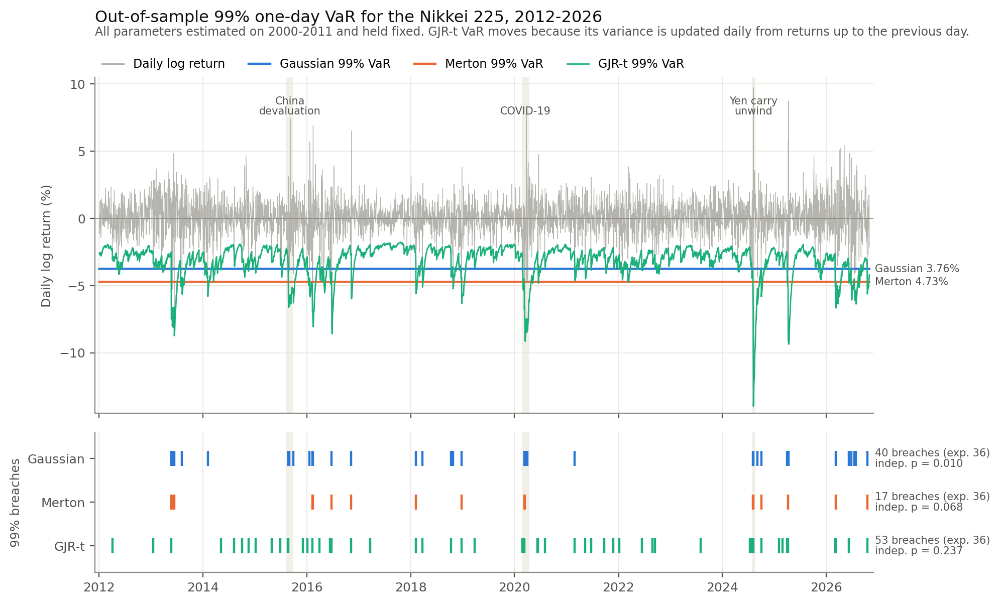

# Nikkei 225: volatility clustering, fat tails and Value-at-Risk

**Question:** can a one-day VaR model estimated on 2000–2011 Nikkei 225 data pass coverage and independence backtests on 2012–2026, and which matters more for that, fat tails (Merton jump-diffusion) or volatility clustering (GARCH)?

**Headline:** volatility clustering matters more. A GJR-GARCH model with Student-t errors removes the breach clustering that sank the Gaussian model: at 99% the Christoffersen independence p-value goes from 0.0095 to 0.24, and the model passes every test at 95%. It does not fix the far tail. With parameters fixed at 2000–2011 values it breaches too often at 99% (53 vs 36 expected) and 99.5% (30 vs 18), so Kupiec rejects. Merton improves the density fit, mostly on ordinary days near zero rather than in the tails. As a VaR model it is too conservative: 17 breaches at 99% vs 36 expected.

The full write-up is [`report/report.pdf`](report/report.pdf) (3 pages).

## Data

| | |
|---|---|
| Source | Yahoo Finance, ticker `^N225`, daily close, `auto_adjust=True`, via `yfinance` |
| Downloaded | 30 October 2026, snapshot committed as [`data/n225.csv`](data/n225.csv) |
| Prices | 4 Jan 2000 – 30 Oct 2026 |
| Returns | 6,569 daily log returns, r_t = 100·ln(P_t / P_{t−1}), in percent |

Everything runs off the committed snapshot, so results are reproducible. `python data.py --refresh` re-downloads and overwrites it, which adds new days and therefore changes the results.

## Train/test split and the walk-forward rule

- **Train:** every return before 1 Jan 2012 (2,943 days, 5 Jan 2000 – 30 Dec 2011).
- **Test:** every return from 1 Jan 2012 (3,626 days, 4 Jan 2012 – 30 Oct 2026).
- **OLS mean forecasts:** expanding walk-forward. For each test day *t* the model is refitted on every day before *t*, so a forecast never uses day *t* or later.
- **VaR models:** one rule for all three. Parameters are estimated once on the training set and never refitted. Gaussian and Merton VaR are therefore constant. GARCH VaR still changes daily because σ²_t comes from the variance recursion using returns up to *t*−1 only. An assertion in `run_all.py` checks this: changing the final return leaves every forecast unchanged.

## Repository structure

```
data.py              download (--refresh), load and split the data
models.py            OLS walk-forward, Gaussian, Merton (own MLE), GARCH family (own MLE + arch)
backtests.py         Ljung-Box, Kupiec, Christoffersen, LR_cc, block bootstrap
plots.py             result figure and QQ plots
run_all.py           entry point: reproduces every table and figure
data/n225.csv        committed data snapshot
results/             CSV tables written by run_all.py
figures/             figures written by run_all.py
report/              LaTeX write-up: report_template.tex -> report.tex -> report.pdf (build_report.py)
exploration/         original interactive task scripts (Tasks 1-6) and their figures, kept for reference only
requirements.txt     pinned versions
```

## Install and run

Tested with Python 3.9.6 on macOS. Rebuilding the PDF also needs `pdflatex` (any TeX distribution; TinyTeX is enough).

```bash
python3 -m venv .venv
source .venv/bin/activate
pip install -r requirements.txt

python run_all.py                 # about 15 s; writes results/ and figures/, prints every table
python report/build_report.py     # fills report_template.tex from results/, compiles with pdflatex
```

The only random step is the block bootstrap, which is seeded (`SEED = 42` in `run_all.py`). A run from a fresh environment produced byte-identical `results/*.csv`.

## Results

Out-of-sample one-day VaR backtests on 3,626 test days. The p-values come from Kupiec unconditional coverage, Christoffersen independence and their combination LR_cc ~ χ²(2). **Bold** means rejected at 5%.

| Model | Level | Breaches (expected) | Kupiec p | Christoffersen p | LR_cc p |
|---|---|---|---|---|---|
| Gaussian | 95% | 110 (181) | **<0.001** | **<0.001** | **<0.001** |
| | 99% | 40 (36) | 0.539 | **0.010** | **0.029** |
| | 99.5% | 25 (18) | 0.126 | **0.011** | **0.012** |
| Merton | 95% | 133 (181) | **<0.001** | **<0.001** | **<0.001** |
| | 99% | 17 (36) | **<0.001** | 0.068 | **<0.001** |
| | 99.5% | 6 (18) | **<0.001** | 0.888 | **0.004** |
| GJR-t | 95% | 176 (181) | 0.685 | 0.610 | 0.808 |
| | 99% | 53 (36) | **0.009** | 0.237 | **0.016** |
| | 99.5% | 30 (18) | **0.011** | 0.250 | **0.020** |



Other findings, all in `results/`:

- **OLS AR(1–5), fitted with scikit-learn:** out-of-sample R² is at most 0.0014 and every |t| is below 0.75, so daily returns are close to unpredictable in the mean.
- **Merton vs Gaussian log score:** Merton gains 0.077 per test day (block-bootstrap 95% CI 0.056–0.104). Days with |r| < 1% contribute 128% of that gain, days with |r| between 2% and 3% subtract 40%, and days with |r| ≥ 3% add 24%. The improvement is mainly a better centre, not better tails.
- **GARCH:**
  - My own GARCH(1,1) MLE matches `arch` to six decimal places once the start-up variance convention is the same.
  - Training fit: α+β = 0.985 and the half-life of a volatility shock is 46 days.
  - Ljung-Box on squared standardised residuals gives p ≥ 0.14 at every lag tested, against p < 0.001 for raw squared returns.
  - GJR-t was chosen on training BIC before any backtest was run. Results for the other variants (GARCH-N, GARCH-t, GJR-N) are in `results/backtests_all_models.csv`.

## Limitations

- **Parameters never refitted:** the test period is calmer than training (daily sd 1.37% vs 1.60%) and has a higher mean. Some of the excess 99% breaches may reflect stale parameters rather than the model itself.
- **Narrow scope:** one index, one split and one data source, and Yahoo data has not been checked against an official series.
- **Multiple testing:** six VaR models × three levels are tested without adjustment.
- **Christoffersen** only detects day-to-day dependence. GJR-t breaches still bunch in 2015, 2020 and 2024 (6, 5 and 5 against about 2.4 expected per year).
- **Model choice:** GARCH-t did better ex post at 99% (LR_cc p = 0.066). It was not chosen, because switching now would be selecting on the test set.
- **Shortcuts:**
  - Ljung-Box on GARCH residuals uses h rather than h−2 degrees of freedom.
  - The OLS t-statistics ignore autocorrelation.
  - The Merton density is truncated at 10 jumps.

## Future work

- An expanding-window refit (for example every 250 days) applied identically to all three models.
- Fatter-tailed or empirical innovations, such as filtered historical simulation.
- A machine-learning baseline for the mean and volatility forecasts.
- **USD/JPY or VIX** as an added explanatory variable, for example in the GARCH variance equation. This was an optional step in the original plan and was not done.
